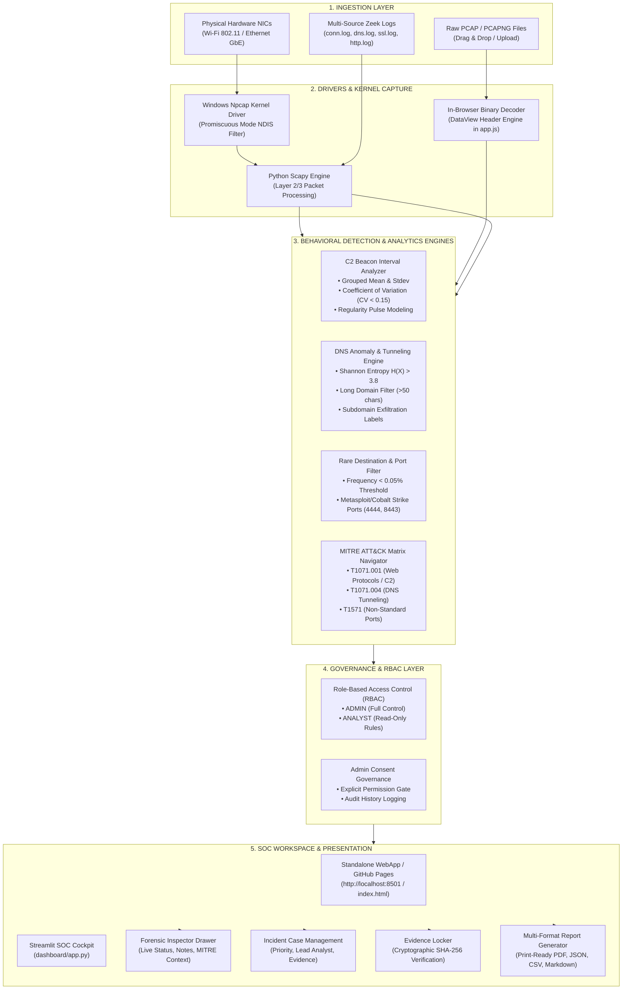
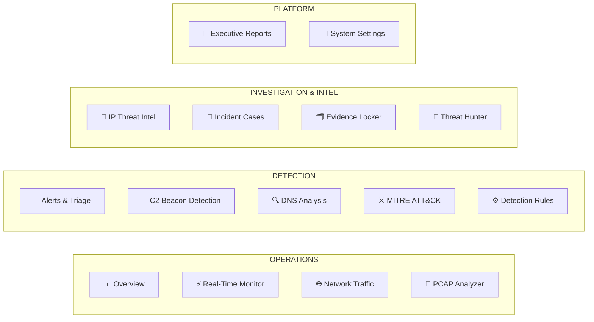

# NetWatch SOC — Enterprise Network Traffic & C2 Detection Platform

[](https://github.com/noobkushal/C2)
[](https://noobkushal.github.io/C2/)
[](http://localhost:8501)
[](LICENSE)
[](README.md)

> **SAFE SIMULATION & DEFENSIVE SECURITY OPERATIONS LAB**  
> NetWatch SOC is a 100% free, open-source, dual-mode Security Operations Center (SOC) platform designed for defensive network analysis, packet forensic inspection, and behavioral Command-and-Control (C2) detection. It features both a **zero-dependency, in-browser Wireshark PCAP analyzer and interactive web app** and a **native hardware sensor engine** capable of sniffing live packets across physical Wi-Fi and Ethernet adapters. All simulation and detection tools operate safely with zero malicious payload capabilities.

---

## 🌐 Live WebApp & Deployments

| Environment | URL / Endpoint | Description |
| :--- | :--- | :--- |
| 🌐 **Live GitHub Pages WebApp** | [https://noobkushal.github.io/C2/](https://noobkushal.github.io/C2/) | Pure client-side interactive SOC platform (runs directly in your browser with zero installations) |
| 💻 **Localhost SOC Application** | [http://localhost:8501/](http://localhost:8501/) | Fast local multi-threaded server (launch with `run_localhost.bat`) |
| 🐙 **GitHub Repository** | [https://github.com/noobkushal/C2](https://github.com/noobkushal/C2) | Complete source code, drivers, and forensic datasets |
| 🚀 **Render Cloud Deployment** | [RENDER_DEPLOYMENT.md](RENDER_DEPLOYMENT.md) | Blueprint configuration for hosted SOC operations |

---

## 🏗️ Architecture Blueprint

NetWatch SOC is designed with a modular, dual-engine architecture that bridges client-side binary packet analysis with host-level hardware kernel packet capture:



---

## 🛡️ Dual-Mode Operating Scenarios

### Scenario A: In-Browser Client-Side WebApp (`index.html` / `http://localhost:8501`)
- **Zero Runtime Dependencies**: Operates entirely in client-side JavaScript, HTML5, and CSS3 without requiring Python, Node.js, or external web services.
- **In-Browser Wireshark Engine**: Directly decodes raw binary `.pcap` and `.pcapng` file byte buffers using `DataView` parsing.
  - Decodes **Ethernet II** (Src/Dst MAC, Type).
  - Decodes **IPv4** (Src/Dst IP, Version, IHL, Protocol, TTL).
  - Decodes **TCP / UDP / DNS / HTTP** headers and displays a full Wireshark-style protocol layer tree alongside an interactive memory offset **Hex & ASCII payload inspector**.
- **Interactive SOC Simulation**: Generates live realistic traffic streams to test triage workflows, alert life cycles, and rule tuning.

### Scenario B: Physical Hardware Packet Sniffer (`src/ingestion/realworld_sniffer.py`)
- **Real-World Promiscuous Sniffing**: Uses the Windows **Npcap kernel filter driver** to capture raw data packets traveling over your laptop's actual **Wi-Fi network card** or **Ethernet cable**.
- **Scapy Packet Normalization**: Captures live IP packets, TCP flags (`SYN`, `ACK`, `PSH`, `FIN`), and DNS queries, piping them into `data/netwatch.db` (SQLite).
- **Automated Anomaly Emitter**: Runs real-time behavioral detectors against live traffic and emits alerts to the SOC cockpit with synthetic Web Audio API alert beeps.

---

## 🚀 1-Click Launchers & Scripts (Windows)

All necessary setup and launch scripts are included in the repository root for instantaneous deployment:

| Script | Purpose | Description |
| :--- | :--- | :--- |
| **[`run_localhost.bat`](run_localhost.bat)** | **Run Localhost Server** | Starts the local multi-threaded SOC web server on **`http://localhost:8501/`** without needing Python or Node.js. |
| **[`setup_live_sniffer.bat`](setup_live_sniffer.bat)** | **Setup Hardware Sniffer** | Installs Npcap and Python 3.11, configures Scapy, and launches the live physical Wi-Fi/Ethernet sniffer as Administrator. |
| **[`install_npcap.bat`](install_npcap.bat)** | **Install Npcap Driver** | Silently installs the bundled Npcap packet capture driver from `installers/npcap-setup.exe`. |
| **[`github_login_and_push.bat`](github_login_and_push.bat)** | **Push to GitHub** | Connects to GitHub CLI, authorizes your account in your browser, and pushes all updates to `origin main`. |
| **[`start_soc.bat`](start_soc.bat)** | **Streamlit Cockpit** | Launches the native Python Streamlit SOC backend dashboard as Administrator. |

---

## 📊 Complete Interactive SOC Suite (14 Core Views)



### 1. Operations Suite
- **📊 Overview Dashboard**: Real-time KPI cards (Network Events, Active Alerts, Criticals, C2 Beacons, Unique Dsts, DNS Queries, Incident Cases, Active Rules). Interactive 1h/6h/24h flow timeline chart, severity donut chart, protocol breakdown, top talkers, and priority triage queue.
- **⚡ Real-Time Monitor**: Hardware NIC selector (`Wi-Fi`, `Ethernet`, `Loopback`, `All`), Berkeley Packet Filter (BPF) input, speed selector (500ms, 1.5s, 3s), Admin Consent governance, real-time packet stream table with row inspection, and anomaly emitter.
- **🌐 Network Traffic**: Raw flow telemetry table with full-text search across IPs, ports, and protocols. Filters for TCP, UDP, ICMP, DNS, connection states (`SF`, `S0`, `REJ`), and flagged threats, with pagination and custom flow injection.
- **🔬 In-Browser PCAP Analyzer**: Drag & drop parser for `.pcap` and `.pcapng` files. Preloaded with 3 threat captures (C2 Beaconing, DNS Exfiltration, TCP SYN Port Scan). Expandable Wireshark layer tree and Hex/ASCII memory inspector.

### 2. Detection & Threat Analytics
- **🚨 Alerts & Forensic Triage**: Severity filters (`CRITICAL`, `HIGH`, `MEDIUM`, `LOW`), status filters (`NEW`, `INVESTIGATING`, `RESOLVED`, `FALSE POSITIVE`). Slide-out **Forensic Inspector Drawer** to update alert statuses, write analyst findings, link MITRE techniques, or escalate directly to an incident case.
- **📡 C2 Beacon Detection**: Mathematical regularity analyzer calculating inter-arrival interval mean, standard deviation, and Coefficient of Variation ($CV < 0.15$). Interactive **Interval Regularity Pulse Chart** visualizing beacon jitter against target clocks with 1-click `iptables` firewall containment copying.
- **🔍 DNS Analysis & Live Shannon Entropy**: Interactive calculator testing any domain against the Shannon Entropy formula $H(X) = -\sum P(x) \log_2 P(x)$, character length, subdomain label count, and DGA likelihood.
- **⚔️ MITRE ATT&CK Matrix**: Visual enterprise matrix covering Reconnaissance, Initial Access, Execution, Defense Evasion, Command & Control, and Exfiltration with active detection indicators and hit counts.
- **⚙️ Detection Rules Engine**: Behavioral rules management table with configurable thresholds, real-time toggle switches, and a custom rule creation modal.

### 3. Investigation & Platform Controls
- **🎯 Host & IP Threat Intelligence**: IP lookup workbench featuring preloaded quick picks (`10.0.0.99`, `192.168.1.100`, `192.168.99.99`, `8.8.8.8`), reputation score gauge, ASN, reverse DNS, geolocation, open ports, correlated alerts, and flow history.
- **📁 Incident Cases**: Formal incident case management tracking investigation lifecycle, priority, lead investigator, and linked alerts.
- **🗂️ Evidence Locker**: Cryptographic SHA-256 artifact verification, raw text/hex previews, real browser downloads, and evidence manifest exports.
- **🔎 Threat Hunter**: Universal telemetry search engine accessible from anywhere by pressing `/`.
- **📄 Executive Reports**: Generates formal, print-ready SOC intelligence reports with live preview, print to PDF (`window.print()`), JSON, CSV, and Markdown exports.
- **🔧 System Settings & Themes**: 4 visual themes (**Dark SOC**, **Cyber Midnight**, **Emerald Matrix**, **High Contrast Dark**), synthesized audio alert toggles, background simulation controls, and state backup/restore.

---

## 🔒 Security & RBAC Matrix

| Role | Default Credentials | Live Physical Sniffing | Grant/Revoke Consent | Detection Rule Triage | Export Reports |
| :--- | :--- | :---: | :---: | :---: | :---: |
| **ADMIN** | `admin` / `Admin@123` | ✅ Yes | ✅ Yes | ✅ Full Edit | ✅ Download |
| **ANALYST** | `analyst` / `Analyst@123` | ❌ No | ❌ No | 👁 Read-Only | ✅ Download |

---

## 📊 Database Schema (SQLite: `data/netwatch.db`)

| Table | Primary Key | Description |
| :--- | :--- | :--- |
| `users` | `user_id` (UUID4) | User account repository, role (`ADMIN`, `ANALYST`), salted SHA-256 password hash |
| `sessions` | `session_token` | Active session tokens, user references, expiration timestamps |
| `admin_permissions` | `permission_id` | Governance status (`GRANTED` vs `REVOKED`), granted_by, timestamp |
| `admin_audit_log` | `log_id` (Autoincrement) | Cryptographic audit history for consent grants, revokes, and security operations |
| `network_events` | `event_id` (UUID4) | Normalized IP flow events from `conn`, `http`, `ssl` logs or live sniffer |
| `dns_events` | `event_id` (UUID4) | Normalized DNS query records from `dns` logs or live sniffer |
| `alerts` | `alert_id` (UUID4) | Correlated security alerts with risk scores and evidence JSON |
| `investigations` | `investigation_id` | Analyst notes, verdicts (`TRUE_POSITIVE`, `FALSE_POSITIVE`), audit history |

---

## 💻 Manual Setup & Development

### 1. Run Pure WebApp (Zero Dependencies)
Simply double-click [`run_localhost.bat`](run_localhost.bat) or open [`index.html`](index.html) directly in any web browser.

### 2. Run Native Python Streamlit Sensor
```bash
# Clone repository
git clone https://github.com/noobkushal/C2.git
cd C2

# Install dependencies
pip install -r requirements.txt

# Run unit test suite
python -m pytest -v

# Launch Streamlit SOC dashboard
streamlit run dashboard/app.py
```

---

## ⚖️ Legal & Safety Disclaimer

> **IMPORTANT**: NetWatch SOC is strictly an educational defense, security research, and network telemetry analysis platform. It contains zero exploit payloads, zero automated attack capabilities, and operates in full compliance with defensive security monitoring governance standards. Network packet capture on hardware interfaces must only be performed on networks and devices you own or have explicit administrative authorization to monitor.
